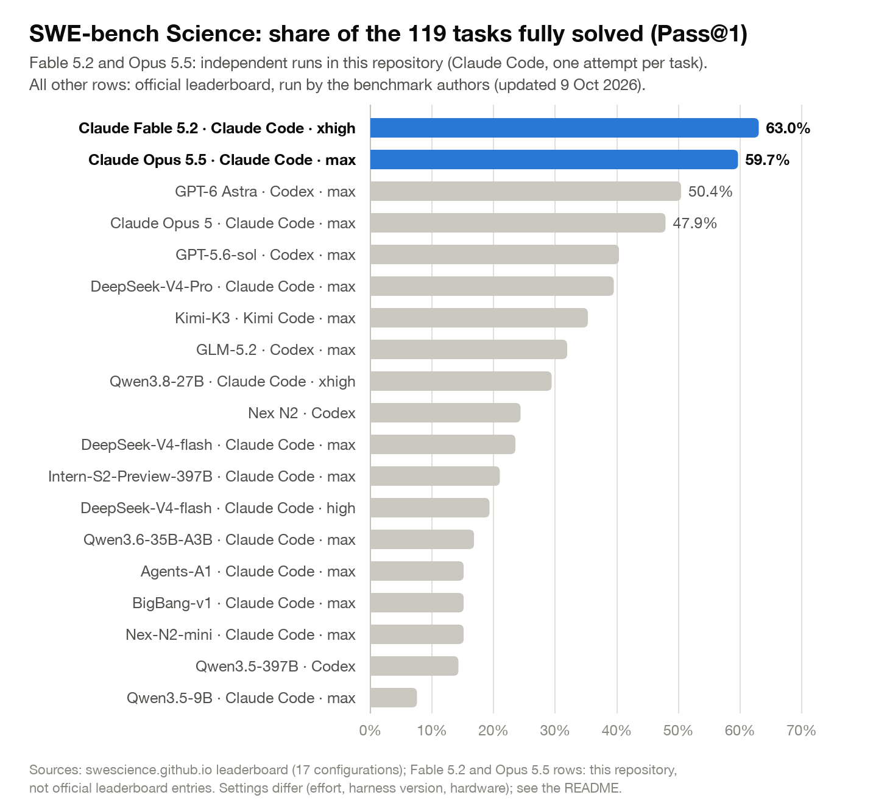
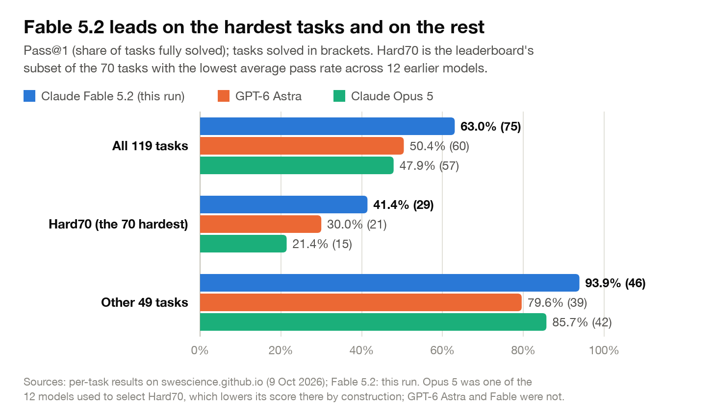

# Claude Fable 5.2 on SWE-bench Science

An independent, unofficial run of Claude Fable 5.2 on all 119 tasks of [SWE-bench Science](https://github.com/OpenMOSS/SWE-bench-Science), using the benchmark's own harness. It was submitted to the benchmark maintainers for review on 2026-11-17 ([OpenMOSS/SWE-bench-Science#4](https://github.com/OpenMOSS/SWE-bench-Science/issues/4)). It is **not** an official leaderboard entry.

| | Pass@1 | Tasks solved |
|---|---|---|
| **Claude Fable 5.2, Claude Code 2.1.293, xhigh (this run)** | **63.03%** (Wilson 95% CI 54.1-71.2) | **75 / 119** |
| GPT-6 Astra, Codex, max (leaderboard, 2026-10-09) | 50.42% | 60 / 119 |
| Claude Opus 5, Claude Code, max (leaderboard, 2026-10-09) | 47.90% | 57 / 119 |

Fable's leaderboard-style metrics:

- Public macro 99.16%.
- Private macro 85.26%.
- Hard70: 29/70 (41.4%). The other 49 tasks: 46/49.
- Default 96-task selection: 60/96. 23 restricted-licence tasks: 15/23.

Fail2Pass, Pass2Pass and the Issue/Expert/Engineering columns cannot be computed from the data in this repository (see [What is not computed](#what-is-not-computed)).





## Contents

- `results/per-task.csv`: one row per task with outcome, public/private pass counts, time, turns, tokens, list cost, patch size and checksum, network mode. The data dictionary is in `results/README.md`.
- `results/runs.jsonl`: the same runs as structured records (sanitised). `results/summary.json`: headline aggregates.
- `leaderboard-format/`: the per-task results in the leaderboard's own `task-matrix.json`, `benchmark.json` and `hard70-model-results.json` schemas, plus a validator.
- `provenance/`: exact command, versions, image digests, per-trial network policy, run order, a dated run log and the pre-release scan.
- `analysis/`: scripts that reproduce every number in this README and in the analysis notes (`analysis/fable-vs-paper.md`).
- `docs/network-scan.md`: the count-only scan of the agent records for network or download attempts.
- `figures/`: the two figures above and the script that draws them.
- `harness/`: the driver, the environment class and the record builder used for the run.

**Not included, on purpose:**

- Task content (instructions, source snapshots, supplied materials).
- Hidden-test code or any verifier output beyond pass counts.
- Agent transcripts and patches.

Some tasks carry restricted licences (GPL family, non-commercial, unclear redistribution rights), and publishing working patches would put benchmark solutions online. The SHA-256 of every patch is listed in `results/artefact-checksums.csv`, and the patches and transcripts are available to the benchmark maintainers for verification.

## Configuration

| Item | Value |
|---|---|
| Model | `anthropic/claude-fable-5-2` (reported by Claude Code as `claude-fable-5-2` on all 119 runs; no other model appears in its usage reports) |
| Agent | Claude Code 2.1.293, the built-in `claude-code` agent of `datacurve-pier==0.3.0`. The task's `instruction.md` is the only prompt. No extra tools, hooks or instructions |
| Effort | `reasoning_effort=xhigh` |
| Output cap | `CLAUDE_CODE_MAX_OUTPUT_TOKENS=128000` |
| Limits | 5400 s agent, 1800 s verifier, 2 CPUs and 8 GB per container (from each `task.toml`; unchanged) |
| Network | Agent: `isolated-allowlist`, only `api.anthropic.com`. Verifier: `none`. Checked on every trial |
| Environment class | the benchmark's `ScienceBenchDocker`, with one change: an Ubuntu mirror for building the egress-proxy image (`harness/environment.py`) |
| Dataset | HF `OpenMOSS-Team/SWE-bench-Science` revision `997408298e8e4d09978b1120b95c4540d1a71bcb`; `manifests/tasks.jsonl` sha256 `bcada90a99fcfd88e67ff4faf38af8ad3dad354b32a5a904a75d378e29ca8d4c`; all 119 tasks materialised with `--allow-restricted-licenses` |
| Attempts | one scored attempt per task; Pier `--n-attempts 1 --max-retries 0` |
| Order | seeded random shuffle of the 119 tasks (seed 20261111; `provenance/run-order.json`) |
| Hardware | native linux/amd64. Server A: Intel Core i9-13900, 64 GB, Ubuntu 24.04.5, Docker 29.9.3, 7 tasks at a time, 92 tasks (13-14 Nov 2026). Server B: Intel Core i5-12500, 64 GB, Ubuntu 24.04.5, Docker 29.10.0, 6 at a time, 27 tasks (17 Nov 2026) |

The exact per-task command is in `provenance/pier-command.txt`; more detail in `provenance/environment.md`.

## Differences from the paper's setup

| | Paper / benchmark repository | This run |
|---|---|---|
| Effort | max | **xhigh** (see below) |
| Output-token cap | not reported (Claude Code default 32,000) | **128,000** |
| Claude Code version | not reported (2.1.221 for one leaderboard entry, per the maintainers) | 2.1.293 |
| Runner | `scripts/run_batch.py` or `pier run` | `pier run` per task through `harness/run_fable.py`, same network policy |
| Hardware | not reported | two native x86 servers (above) |
| Interrupted sessions | not reported | set aside and rerun from scratch (see Run integrity) |
| Time-limit runs | scored on workspace (Pier) | same: 3 runs (062, 107, 108), all pass |

**Why xhigh.** The run started at max. After 47 minutes, none of the first seven tasks had finished, and the pass was switched to xhigh for cost and time. The switch was made before any max-effort outcome existed.

**Why 128k output tokens.** In a test run at the default cap, a max-effort session ended with an API error when a response exceeded 32,000 output tokens.

## How scoring works

- Each patch is evaluated by the benchmark's own verifier image and grader in a separate container without network access.
- A task counts as solved (Pass@1 = 1) when every private test passes. The grader's reward also requires the public reproduction to pass. In this run the two coincide on all 119 tasks. The public reproduction passes on 118 of 119.
- With one attempt per task, Pass@1 is the mean of 119 binary rewards: 75/119 = 63.03%. The 95% interval (54.1-71.2) is a Wilson interval treating the 119 tasks as a sample. It covers task sampling only. Run-to-run variation was not measured for Fable.
- **Time limit.** Three runs hit the 90-minute agent limit and are scored on their final workspace, as Pier does. All three pass. Scored as failures instead, the result would be 72/119 = 60.5%.
- **Verifier timeout.** On task 002 the agent finished normally, but the verifier ran 60 minutes without a result. It counts as a failure. In the leaderboard format it is recorded as 0 of the leaderboard's test totals, the convention the leaderboard uses for an evaluation that produced nothing.
- **Public and private macro values** follow the paper's definition: the mean over tasks of the share of tests passed.

## Comparison with the leaderboard

The leaderboard publishes per-task results for seven configurations (<https://swescience.github.io/task-matrix/gradient/>). `analysis/fetch_inputs.py` downloads them from the site repository at commit `f16153e5c47c46b2f6f2ebf0aaefae34bdf8c8bd`, and the analysis pairs them with this run task by task.

| Against | Only Fable solves | Only the other solves | Exact McNemar p |
|---|---|---|---|
| GPT-6 Astra (max, Codex) | 20 | 5 | 0.0041 |
| Claude Opus 5 (max, Claude Code) | 20 | 2 | 0.00012 |

- Fable solves 6 of the 35 tasks that none of the seven configurations solves (036, 065, 068, 090, 097, 113).
- With the three time-limit runs scored as failures, Fable still leads Astra 18 to 6 (p = 0.023).

This is not a matched comparison. The leaderboard runs were made by the benchmark authors at max effort, with Claude Code or Codex versions, output caps and hardware that are not all reported. The paired test controls for task difficulty, not for those conditions. More in `analysis/fable-vs-paper.md`.

### What is not computed

- **Fail2Pass / Pass2Pass.** These need per-test results before and after the patch. This run's records hold pass counts only, and no per-test verifier output was opened. The maintainers can compute them by re-evaluating the patches.
- **Issue / Expert / Engineering Pass@1.** The task-to-paradigm labels are not published. `analysis/paradigm_bounds.py` shows that the split of Fable's result is not identifiable from public data.
- **Task 032.** Our verifier image collects 6 private tests, while the leaderboard lists 21. The task passes either way.

## Run integrity

- **Network.** Every trial ran with the benchmark's isolated network policy: the agent could reach only `api.anthropic.com` through the proxy, and the verifier had no network. The policy files are summarised per task in `provenance/per-task-provenance.jsonl`. Claude Code reports 0 web-search requests in all 116 runs that report usage; the 3 time-limit runs end without a usage report. A count-only scan of all 119 agent records, with patterns fixed before scanning (`analysis/contamination_scan.py`, `docs/network-scan.md`), found no use of the web-fetch or web-search tools (available in every run) and no curl, wget, git clone/fetch/pull, ssh or system package manager. The agent tried `pip download` 20 times in 19 runs, sometimes for a specific release of the package it was repairing; every one of those attempts returned a blocked-network error, and no result of any network attempt shows a successful download. The scan cannot see network calls made from inside scripts the agent ran from files, except through their printed output. Most transcripts belong to a held-out research set and were scanned mechanically without being read. The 26 flagged runs are listed by task ID with their counts, 14 of them never read, for the maintainers to inspect.
- **Usage limits and interruptions.** The run used a Claude subscription and hit its usage limit twice. Sessions cut off by the limit, and runs interrupted when the first server was shut down, were discarded and the task was rerun from scratch. They were never scored and are not part of this repository. The rule looks only at the session's error text, never at the verifier result (`harness/run_fable.py`, `session_error` and `do_entry`). Timeline: `provenance/run-log.md`.
- **Credentials.** A scan for the OAuth token prefix found 0 hits in every job folder and Pier log. The published files were scanned again before release (`provenance/release-scan.md`).
- **Hidden tests.** No hidden-test source or verifier output (`test-stdout.txt`, `junit.xml`, `ctrf.json`, `run.log`) was opened at any point. Only the count file `reward.json` was read.

## Caveats

- One attempt per task. A rerun could move the total by a few tasks.
- Not a matched comparison with the leaderboard (effort, Claude Code version, output cap, hardware).
- xhigh rather than the paper's max effort; output cap raised to 128k. Claude Code's usage report lists `maxOutputTokens: 32000` in every run, but that field does not reflect the effective cap: in the 41 runs whose session files we inspected, 18 single responses exceeded 32,000 output tokens (the largest 91,727), which the default cap would have ended with an API error. The raised cap was therefore in effect and was used.
- Two servers, run 3-4 days apart. The order was random, so the split is not tied to task difficulty (server A 56/92, server B 19/27).
- Three time-limit runs scored on workspace state, and one verifier timeout scored as a failure (see above).
- List cost ($488 in total, $4.21 per task, for the 116 runs that report it) is Claude Code's own estimate at API list prices, not what was paid.

## Reproduce

Requirements: a native linux/amd64 host with Docker Engine 28+, Python 3.12+, about 2 CPUs and 8 GB RAM per concurrent task, and an Anthropic credential that can use `claude-fable-5-2`.

```bash
# 1. Harness and dataset (pinned)
python3.12 -m venv .venv && .venv/bin/pip install -r harness/requirements.txt   # datacurve-pier==0.3.0
hf download OpenMOSS-Team/SWE-bench-Science --repo-type dataset \
  --revision 997408298e8e4d09978b1120b95c4540d1a71bcb --local-dir swe-bench-science
(cd swe-bench-science && python3 scripts/materialize.py --allow-restricted-licenses \
  --output tasks-selected-all --force)    # restricted-licence opt-in: check that your use is permitted

# 2. Credentials, outside the repository
mkdir -p ~/.config/swe-bench-science && chmod 700 ~/.config/swe-bench-science
cp swe-bench-science/profiles/claude.env.example ~/.config/swe-bench-science/claude.env   # set ANTHROPIC_AUTH_TOKEN
chmod 600 ~/.config/swe-bench-science/claude.env

# 3. Run all 119 tasks in the published order (--dry-run prints the order and one Pier command)
.venv/bin/python -m harness.run_fable --bench swe-bench-science --tasks-dir tasks-selected-all \
  --run-dir runs/fable-xhigh --order provenance/run-order.json --concurrency 7

# 4. Records and analysis
.venv/bin/python -m harness.record runs/fable-xhigh/jobs --tasks-dir swe-bench-science/tasks-selected-all \
  --out runs.jsonl --csv runs-summary.csv
.venv/bin/python -I analysis/fetch_inputs.py
.venv/bin/python -I analysis/fable_vs_paper.py
```

To check the published numbers without rerunning anything, only the last two commands are needed (see `analysis/README.md`). `analysis/tool_mix.py` and `analysis/contamination_scan.py` need the agent transcripts, which are not published; their outputs are committed in `analysis/out/`.

## Licence and attribution

- Code (`harness/`, `analysis/*.py`, `figures/make_figures.py`, `leaderboard-format/validate_entry.py`): MIT, see `LICENSE`.
- Results, provenance, figures and documentation: CC BY 4.0, see `LICENSE-DATA.md`.
- Third-party inputs keep their own terms (`NOTICE.md`):
  - Task metadata columns from the SWE-bench Science dataset (MIT, OpenMOSS).
  - Domain labels from Table 5 of the paper (arXiv 2608.19799, CC BY 4.0).
  - Leaderboard figures quoted with their source. The leaderboard's data files are downloaded by `analysis/fetch_inputs.py`, not redistributed.
- SWE-bench Science task content, images and tests belong to their respective owners and are not part of this repository.

Please cite the benchmark:

```bibtex
@article{xu2026swebenchscience,
  title   = {SWE-bench Science: Can Coding Agents Resolve Engineering Tasks in Science?},
  author  = {Xu, Zhipeng and Lu, Jiahao and Zheng, Yining and Wang, Yuxin and Qiu, Xipeng},
  journal = {arXiv preprint arXiv:2608.19799},
  year    = {2026}
}
```

To cite this run, see `CITATION.cff`.

## Disclosure

Independent run by Daniil Belazovschi (daniswhoiam). I ran this independently. I am not affiliated with Anthropic or with the SWE-bench Science authors. The model was used through a Claude subscription. The servers were rented by the author.

Contact: [GitHub issues on this repository](https://github.com/daniswhoiam/swe-bench-science-fable-5.2/issues).

## Changelog

- v1.0 (2026-11-17): Claude Fable 5.2, xhigh, 119 tasks.
- Planned: a matched Claude Opus 5.5 xhigh run under the same configuration.
